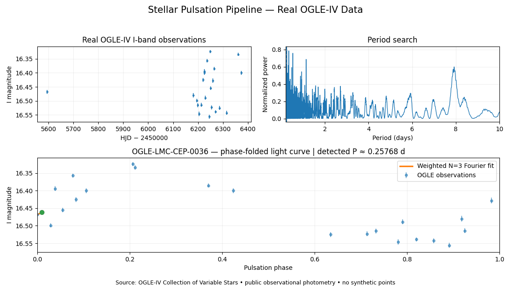
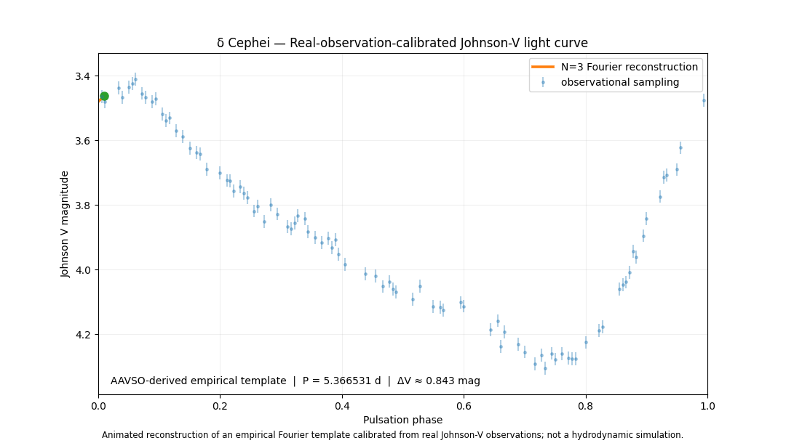

# Stellar Pulsation Real-Data Pipeline

A scientific Python pipeline for retrieving **real public variable-star photometry**, preserving provenance, and running period search, phase folding, weighted Fourier analysis, morphology diagnostics, optional Bayesian photometric inference, and publication-ready visualization.

## Demonstrations

### Real OGLE-IV photometry

Public OGLE-IV observations shown alongside the period search and
phase-folded Fourier reconstruction.



### Delta Cephei light-curve reconstruction

An animated Fourier reconstruction of an empirical Johnson-V light-curve
template calibrated from observations. This is a light-curve visualization,
not a hydrodynamic simulation.



## What changed in v2

The program is no longer centered on a synthetic demonstration. With no command-line source specified, it opens an interactive source menu and lets the user choose a public archive. If the selected archive has no usable data for the requested target/band, the program reports that condition and returns to source selection; it never silently substitutes another star or catalog.

### Credential-free remote sources

1. **AAVSO International Database**: anonymous public light-curve retrieval through the VSX/AID route. Common variable-star names/identifiers can be used; select a homogeneous band such as Johnson V when possible.
2. **OGLE-IV OCVS**: anonymous direct access to public time-series photometry. Exact OGLE identifiers are preferred. For common names, the adapter can resolve coordinates through CDS Sesame and search configured OCVS pulsating-variable identification tables for a positional match.
3. **TESS / MAST**: anonymous public TESS light curves through Lightkurve. Flux is converted to **relative magnitude** and is never treated as calibrated Johnson V.

A **Local CSV/ASCII** source remains available for externally downloaded photometry.

### Why ASAS-SN is not an automated remote source

ASAS-SN data are scientifically useful, but this project intentionally does **not** automate the legacy public web form because that interface explicitly says not to script it and uses CAPTCHA. The current Sky Patrol Python client documentation requires a username/token. To preserve the project's “no credentials / no bypass” rule, ASAS-SN is supported only as a local exported file.

## Installation

```bash
python -m pip install -e .
```

TESS support is intentionally optional because Lightkurve is comparatively heavy and is only needed for the TESS adapter:

```bash
python -m pip install -e ".[tess]"
```

For development/testing:

```bash
python -m pip install -e ".[test]"
```

## Interactive use

```bash
stellar-pulsation
```

or:

```bash
python -m stellar_pulsation.cli
```

The program displays:

```text
Available data sources:
  1. AAVSO International Database [aavso]
  2. OGLE-IV Collection of Variable Stars [ogle]
  3. TESS / MAST [tess]
  4. Local CSV / ASCII file [local]
  5. Synthetic benchmark [synthetic]
  q. Quit
```

For a remote source, it then asks for the target and photometric band. A target miss is explicit, and the user may choose another source.

## Non-interactive examples

AAVSO Johnson V:

```bash
stellar-pulsation --source aavso --target "Delta Cep" --band V --outdir out_delta_cep
```

OGLE exact identifier:

```bash
stellar-pulsation --source ogle --target "OGLE-LMC-CEP-0005" --band I --outdir out_ogle
```

TESS:

```bash
stellar-pulsation --source tess --target "RR Lyr" --outdir out_tess
```

Local file (including a manually exported ASAS-SN CSV):

```bash
stellar-pulsation --source local --data-file star.csv --target "My Star" \
  --time-col 0 --mag-col 1 --err-col 2 --band V --time-system JD
```

List source policy without running an analysis:

```bash
stellar-pulsation --list-sources
```

## Output

Each run writes:

- `raw_photometry.csv`: normalized time, magnitude, uncertainty, band, source, target
- `raw_photometry.metadata.json`: provenance URL, native time system, source identifier, retrieval metadata
- `summary.png`: real-data time series, Lomb–Scargle periodogram, phase-folded weighted Fourier fit, residuals
- `results.json`: period, Fourier/morphology diagnostics, MCMC diagnostics, provenance and analysis scope
- `pulsation.gif`: **synthetic mode only**; real observations do not receive a physically misleading stellar-radius animation

## Scientific safeguards

- Lomb–Scargle discovery uses Astropy's baseline-aware grid and continuous local peak refinement.
- Fourier fitting is weighted linear least squares in sine/cosine coefficients.
- Robust clipping uses MAD; phase-aware clipping is used after period recovery.
- Irregular sampling does not blindly use Savitzky–Golay detrending.
- TESS photometry is labelled relative and excluded from Johnson-V PL zero-point checks.
- Single-band photometry is not claimed to independently determine radius, temperature, distance and pulsation morphology.
- The constrained physical MCMC keeps harmonic morphology fixed and fits only explicitly constrained physical scale parameters.
- Remote parsers are schema-aware and fail loudly on unexpected formats rather than guessing columns.
- Every downloaded data set is saved locally with provenance before analysis.

## OGLE target resolution

Exact OCVS identifiers are the most reliable. Supported pulsating-variable collection prefixes include classical Cepheids, Type-II Cepheids, anomalous Cepheids, RR Lyrae, and selected delta-Scuti collections in LMC/SMC/Galactic disk/bulge where corresponding OCVS directories exist. Common-name resolution depends on CDS Sesame and a positional match to the configured OGLE identification tables; if no match is found within the configured radius, the program reports “not found.”

## AAVSO note

The anonymous `api.object&...&csv` route returns object metadata in an XML wrapper with the observation table embedded as CSV in the data section. The adapter explicitly extracts and parses that payload; tests include both plain-CSV and XML-wrapped fixtures. AAVSO contains heterogeneous observations from many observers and methods. For quantitative Fourier work, use a homogeneous passband and inspect observer/systematics when scientific publication quality is required. The pipeline preserves the source and band but does not pretend heterogeneous observations are automatically on a perfect common zero point.

## Synthetic benchmark

Synthetic/semi-empirical mode remains for regression tests and teaching, including the calibrated delta-Cep Johnson-V morphology benchmark. It is no longer the default scientific workflow and is explicitly labelled synthetic.

## Tests

```bash
pytest -q
```

Remote-source unit tests use mocked HTTP responses so CI does not depend on live archive uptime. The suite also contains an observational-render regression test that passes the real `fit_fourier_series()` result into `render_observational_summary()`, plus an end-to-end local-file CLI integration test covering acquisition → preprocessing → Lomb–Scargle → Fourier fit → rendering → output files. Real remote endpoint behavior should additionally be checked with a network-enabled integration run before a tagged final release.

## References/data services

- AAVSO International Database / VSX public data access.
- OGLE-IV Collection of Variable Stars (OCVS), University of Warsaw.
- TESS data products hosted by MAST/STScI and accessed through Lightkurve.
- ASAS-SN Sky Patrol is documented as a local-file-only path in this project because authenticated/anti-automation constraints apply to its current automated/public interfaces.
- Scientific-model references from the prior release remain applicable to Fourier morphology, bolometric corrections, PL diagnostics and the delta-Cep benchmark.

## Release status

`2.0.0rc2` is a release candidate. It represents a major architecture change from a demo-oriented pipeline to real public data retrieval. Promote to `2.0.0` after the full dependency-backed CI suite and at least one network-enabled integration test for each remote archive pass in the release environment.
